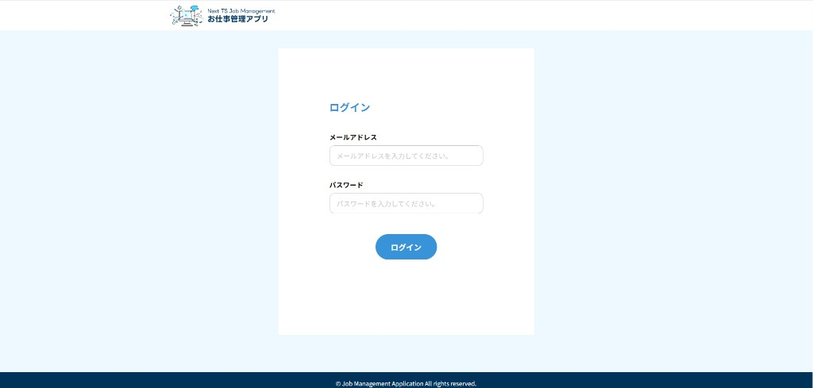
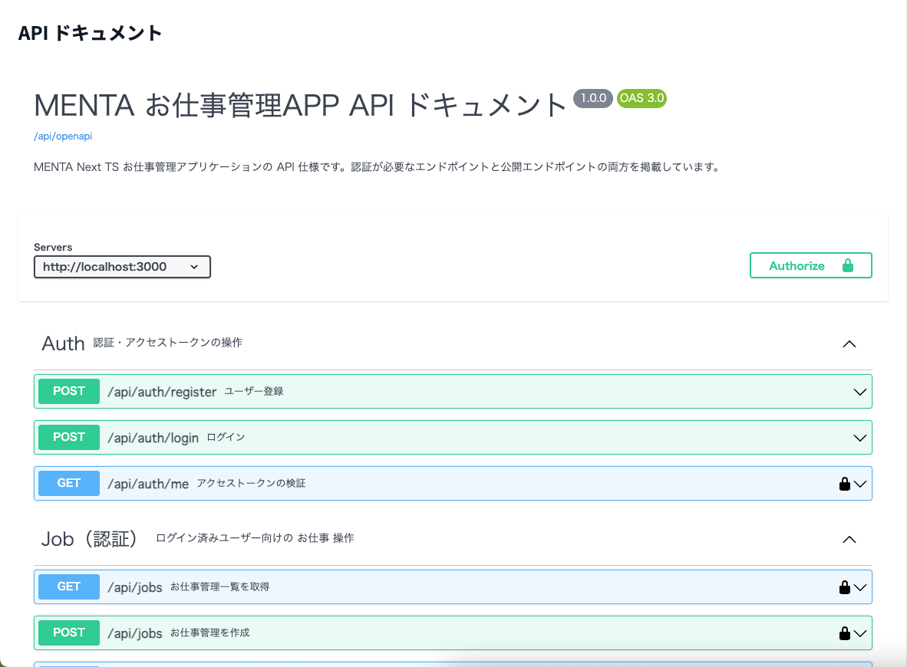

# Job Management Portfolio

Next.js（App Router）と TypeScript で実装したお仕事管理アプリのポートフォリオです。


## 技術スタック

- Next.js 14
- React 18
- TypeScript 5
- Tailwind CSS 3
- TanStack Query
- Supabase
- react-hook-form / zod

## セットアップ

```bash
cp .env.sample .env
npm install
npm run dev
```

ブラウザで [http://localhost:3000](http://localhost:3000) を開いてください。



## Features アーキテクチャ

機能（ドメイン）単位でコードをまとめる設計を採用しています。
ページや機能が増えても「どこに何を書くか」が明確で、変更の影響範囲を小さく保てます。

- **機能ごとに閉じる**：`features/job` や `features/job-category` に、その機能専用のコンポーネント・型・バリデーション・モックを集約
- **共通 UI は分離**：ビジネスロジックを持たない部品は `components/ui-parts` に置き、全体で再利用
- **ページは薄く**：`app/` 配下は、ルーティングと `features` のコンポーネント呼び出しに専念
- **依存の向き**：`app` → `features` → `components` / `hooks` / `utils` / `constants` / `types`（逆方向の依存はしない）

参考：[bulletproof-react](https://github.com/alan2207/bulletproof-react)

## ディレクトリ構成

```
src
├── app                        # ルーティング（Next.js App Router）
│   ├── (guest)                # ログイン前ページ
│   ├── member                 # ログイン後ページ
│   └── api                    # Route Handlers を用いたバックエンド API
│
├── components                 # ビジネスロジックを持たない共通 UI
│   ├── layouts                # レイアウト（Guest / Member）
│   └── ui-parts               # ボタン・カード・フォームなどの UI パーツ
│
├── features                   # 機能ごとのディレクトリ
│   ├── auth                   # 認証
│   ├── job                    # お仕事
│   │   ├── components         # 機能専用コンポーネント（create / detail / list）
│   │   ├── helpers
│   │   ├── mocks
│   │   ├── types
│   │   └── validations        # zod スキーマ
│   ├── job-category           # お仕事カテゴリー
│   │   ├── api
│   │   ├── components         # create / detail / edit / list
│   │   ├── mocks
│   │   ├── types
│   │   └── validations
│   ├── master                 # マスターデータ（都道府県など）
│   └── example                # サンプル表示
│
├── hooks                      # 共通カスタムフック
├── constants                  # 定数（エンドポイント・リンク・HTTP ステータス）
├── server                     # サーバー側ロジック（認証・OpenAPI 定義・Supabase）
├── styles                     # グローバルスタイル・フォント
├── types                      # 共通の型定義
└── utils                      # 共通関数（api / date / animation）
```

## API Docs

開発サーバー起動後: [http://localhost:3000/api/docs](http://localhost:3000/api/docs)


